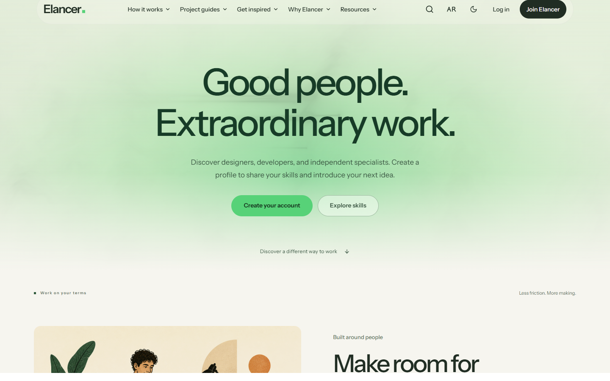
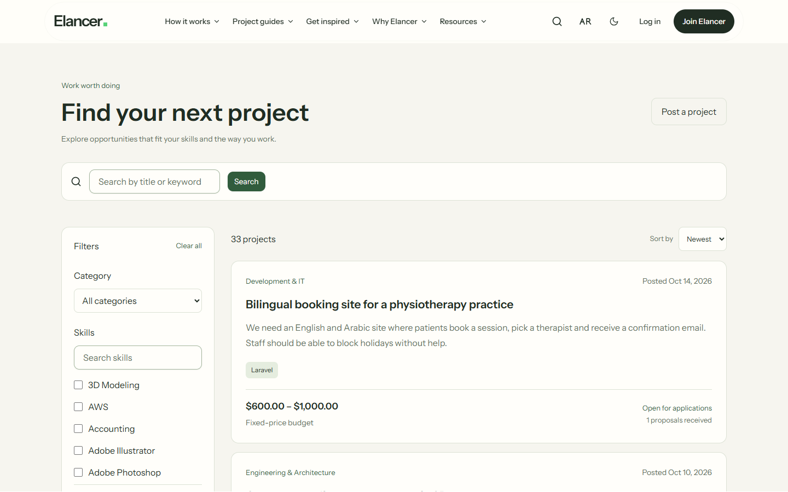
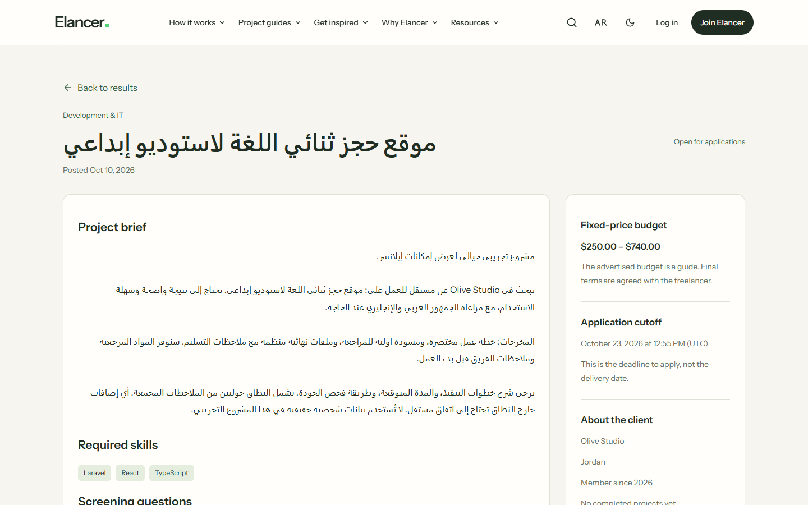
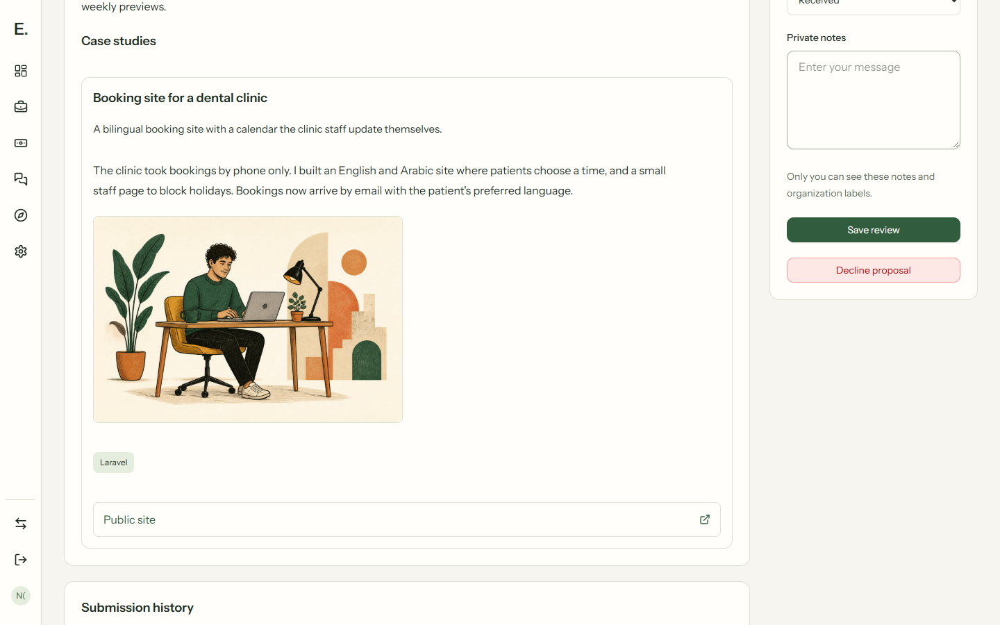
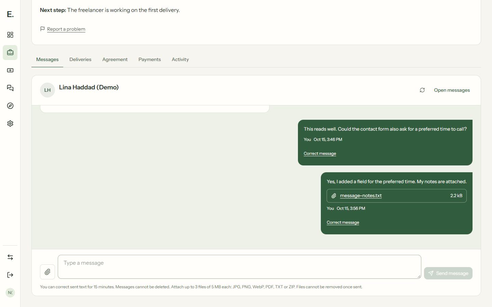
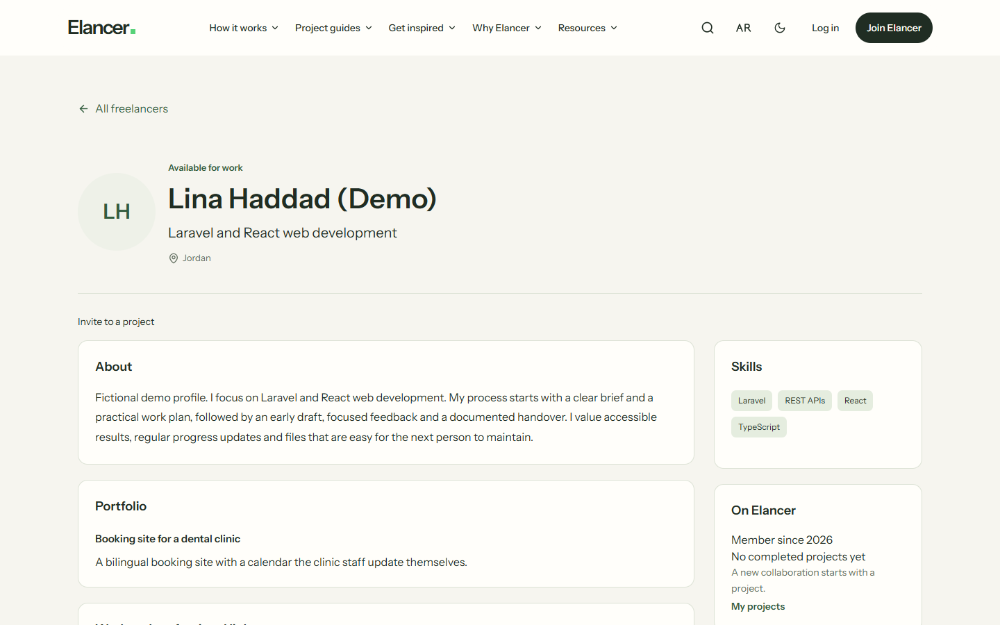
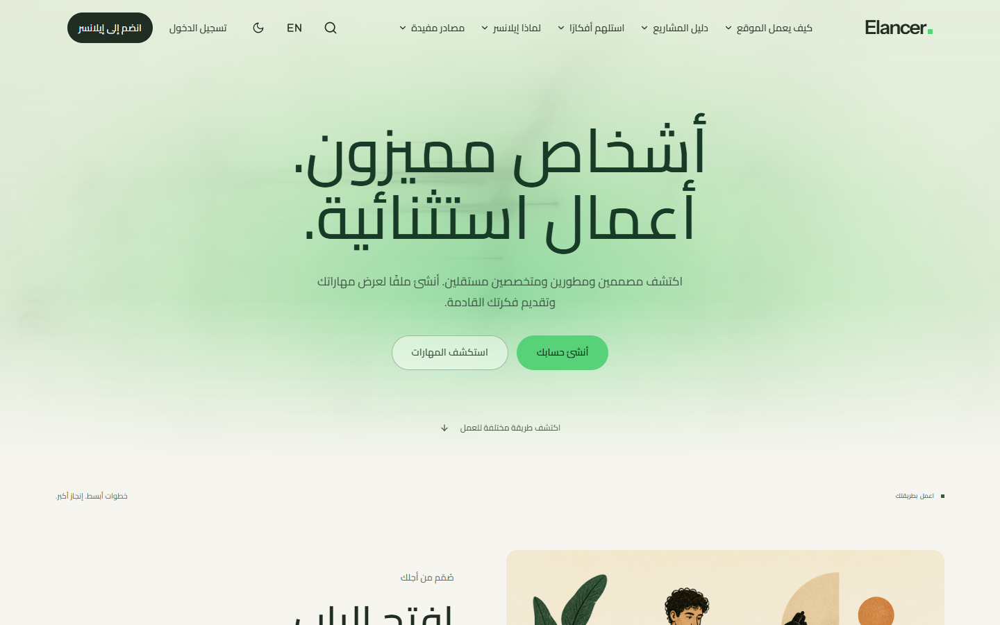

# Elancer

Elancer is a freelance marketplace in English and Arabic. Clients post fixed-price projects and hire one freelancer per project. Freelancers publish a profile, apply with proposals and deliver the agreed work.

It is a portfolio project. Payments run in provider test mode only: no real money moves, and nothing is paid out.

**Live site: [elancer.onrender.com](https://elancer.onrender.com).** It runs on a free plan that sleeps when nobody uses it, so the first page can take up to a minute to appear. To look around without registering, open the login page and choose **Explore as a client** or **Explore as a freelancer**: both open prepared demo accounts that can act, and an administrator can return them to a saved starting point.



## Walkthrough

One project, from the brief to the review. Every step below works on the live site.

1. **The client posts a project.** A guided draft saves itself as it is written. It gets a category, skills, a target budget or a range, an application cutoff, up to three screening questions and up to three files. Publishing puts it in [Find work](https://elancer.onrender.com/jobs).

    

2. **Freelancers apply.** A freelancer needs a public profile first. The project page shows how many proposals arrived, never who sent them. A proposal holds a price, a duration in days, a cover message, the answers to the client's questions, up to three links, up to three files and up to three case studies from the freelancer's portfolio. It stays a private draft until it is submitted.

    

3. **The client compares and talks.** Proposals can be shortlisted, archived, annotated privately and compared three at a time. A case study arrives as it was when the proposal was sent, so the client keeps exactly what they were shown. Only the client can open a conversation, and only about a proposal they received.

    

4. **A final offer becomes a contract.** The offer names the scope, the deliverables, the price, the duration and the revision rounds. It expires after 72 hours, and a project has one pending offer at a time. Accepting it creates a contract that waits for funding.

5. **The client funds it in test mode.** Funding goes through Stripe or Moyasar test checkout. The contract starts only after the server has asked the provider itself; coming back from the checkout page is not enough.

6. **The work happens in the workroom.** The contract page keeps Messages, Deliveries, Agreement, Payments and Activity together. A delivery is the complete set of deliverables, with files and links. One revision request groups every change and uses one round. Both sides can agree to change dates or add rounds; the price never goes up.

    

7. **Completion and reviews.** The client approves the delivery. Each side leaves one review, published when both are in or after 14 days. The freelancer can then ask the client to approve a public case study about the work.

    

A funded contract can also be cancelled by agreement; it ends only after the provider confirms the refund.

The whole site works in Arabic, right to left:



## What works today

### Accounts

- Registration by email with verification and password recovery, or sign-in with Google or GitHub.
- Two-factor authentication and passkeys.
- Four-step onboarding that sets the workspace (client or freelancer), profile, photo and location. One account can switch between the client and freelancer workspace later.
- Profile photos can be cropped, zoomed and rotated, and pass an automated safety check before they are stored.

### Projects and discovery

- Guided project drafts with autosave, recovery when two tabs save different versions, and a Trash with restore.
- Up to three files on a brief: JPG, PNG, WebP, PDF or TXT, 5 MB each, downloaded only by signed-in members.
- After publishing, the client can extend the cutoff and add dated clarifications; applicants are told.
- Project search by keyword, category, skills (any or all), budget, posting date and number of proposals.
- A talent directory with skill and availability filters, and public freelancer profiles with reviews, average ratings and case studies.
- Saved projects, saved searches and saved freelancers.
- The client's history on a brief: completed projects and the reviews freelancers left, with their average.

### Hiring

- Private proposal drafts with autosave, submission, revision history, withdrawal and resubmission.
- Proposals carry links, files and published case studies. Each submitted version keeps the files and case studies it was sent with.
- Clients shortlist, archive, keep private notes, decline, reopen and compare up to three proposals.
- Invitations to an open project, with a seven-day wait before inviting again after a decline.
- Private conversations that only the client can start, and only after a proposal exists. Messages can carry up to three files.
- Senders can correct a message for 15 minutes; the correction is marked and its history kept.
- Final offers with scope, named deliverables, price, duration and revision rounds. An offer expires after 72 hours, and a project has one pending offer at a time.

### Contracts

- Funding through Stripe or Moyasar in test mode, confirmed by the server with the provider.
- A workroom with the contract's conversation, deliveries (files and links), grouped revision requests, agreed changes to dates and revision rounds, and an activity record.
- Cancellation by mutual agreement. A funded contract ends only after the provider confirms the refund.
- Completion, then one review from each side (1 to 5 stars and text), published when both are in or after 14 days.
- Portfolio case studies with images. A case study about work done on Elancer is published only after the client approves the exact content, and the client can withdraw that approval later; a withdrawal also hides it from proposals it was sent with.

### Safety and administration

- Members can report projects, profiles, messages, contracts and case studies, follow the progress of their reports, and block other members.
- Administrators work through a report queue, read a reported conversation with that access recorded, and hide or restore a reported message, project or case study.
- Administrators suspend and reinstate ordinary members with a reason. A suspended member keeps restricted access to existing contracts.
- Category and skill management, failed background work, administrator access managed by a super administrator, manual identity review, and the demo's saved starting point.
- Administration pages require two-factor authentication in the current session. Moderation, suspension and access changes need a reason and leave an audit record.

### Across the application

- English and Arabic for every interface string, with right-to-left layout for Arabic.
- Light and dark themes, usable from phone width to desktop.
- In-app notifications with live updates, and email by category. A conversation's email waits 15 minutes and is skipped once it is read; it says how many messages wait, never what they say.
- A searchable Help centre in both languages.
- Upload budgets of 25 MB per account and 750 MB for the site.

## API

Members can create personal access tokens under Settings, API tokens, choosing what each token may do (`projects:read`, `proposals:read`, `proposals:write`) and when it expires. The secret is shown once.

```bash
TOKEN=your-token
BASE=https://elancer.onrender.com/api/v1

# The account behind the token
curl -H "Authorization: Bearer $TOKEN" -H "Accept: application/json" "$BASE/me"

# Open projects, 20 at a time
curl -H "Authorization: Bearer $TOKEN" -H "Accept: application/json" "$BASE/projects?per_page=20"

# Save a proposal as a private draft (version 0 when there is none yet)
curl -X PUT -H "Authorization: Bearer $TOKEN" -H "Accept: application/json" -H "Content-Type: application/json" \
  -d '{"action":"save","version":0,"price":"450","duration_days":7,"message":"I will build it in both languages and test it on phones.","answers":[],"samples":[]}' \
  "$BASE/projects/42/proposal"

# Your proposals, and withdrawing one
curl -H "Authorization: Bearer $TOKEN" -H "Accept: application/json" "$BASE/me/proposals"
curl -X POST -H "Authorization: Bearer $TOKEN" -H "Accept: application/json" -H "Content-Type: application/json" \
  -d '{"version":3}' "$BASE/me/proposals/7/withdraw"
```

Saving and withdrawing follow the same rules as the pages. A request with an out-of-date `version` is refused with `409` and the current proposal, so a stale copy never overwrites a newer one. Demo accounts cannot create tokens.

## Stack

| Layer    | Tools                                                                                    |
| -------- | ---------------------------------------------------------------------------------------- |
| Backend  | PHP 8.3, Laravel 13, Fortify, Socialite, Sanctum, Reverb                                 |
| Frontend | React 19, TypeScript, Inertia 3, Tailwind CSS 4, Vite                                    |
| Database | MySQL in local development, PostgreSQL on Supabase for the hosted site, SQLite for tests |
| Quality  | PHPUnit, PHPStan (Larastan), Pint, and a translation coverage check                      |

The live site runs as a Docker image on Render's free plan in Frankfurt, with its database and private file storage on Supabase, email through Brevo, live updates through Pusher, and payments in Stripe and Moyasar test mode.

### Why Supabase

Laravel does not need Supabase. It runs on any MySQL or PostgreSQL server, and this application uses Supabase as a managed PostgreSQL database, reached through Laravel's ordinary database connection, and on the hosted site as private file storage, reached through Laravel's S3 storage driver. Supabase Auth and the Data API are not used: sign-in and permissions stay in Laravel, and every uploaded file is handed out by the application after it has checked who is asking.

Supabase was chosen so the author could learn it, and PostgreSQL with it, on a real project: private schemas, separate roles for migrations and for the running application, verified TLS connections, and moving existing data from MySQL without losing it.

## Getting started

You need PHP 8.3, Composer 2 and Node.js 22.

```bash
git clone https://github.com/ahmedMhamdan/Elancer.git
cd Elancer
composer setup
composer dev
```

`composer setup` installs the dependencies, creates `.env` from `.env.example`, generates the application key, runs the migrations and builds the frontend. The example environment uses SQLite, so no database server is needed for a first run. `composer dev` starts the local development processes; the application is then at `http://localhost:8000`.

### First administrator

Register an account, verify its email, then run:

```bash
php artisan app:make-super-admin you@example.com
```

Turn on two-factor authentication for that account before opening the administration pages.

## Configuration

Everything below is optional. Without it the related feature stays off, and the rest of the application works. Variable names are in `.env.example`; never commit real values.

| Feature               | Variables                                                                        | Notes                                                                                                  |
| --------------------- | -------------------------------------------------------------------------------- | ------------------------------------------------------------------------------------------------------ |
| Email                 | `MAIL_*`                                                                         | Written to the log by default. Emails are queued, so a queue worker must be running.                   |
| Live updates          | `BROADCAST_CONNECTION`, `REVERB_APP_*`                                           | Set the connection to `reverb` and run `php artisan reverb:start`.                                     |
| Google and GitHub     | `GOOGLE_*`, `GITHUB_*`                                                           | Register the exact callbacks `/auth/google/callback` and `/auth/github/callback` with each provider.   |
| Stripe test payments  | `STRIPE_TEST_SECRET_KEY`, `STRIPE_WEBHOOK_SECRET`                                | Only `sk_test_` keys are accepted. The webhook at `/payments/webhooks/stripe` is off without a secret. |
| Moyasar test payments | `MOYASAR_TEST_SECRET_KEY`                                                        | Only `sk_test_` keys are accepted.                                                                     |
| Photo safety check    | `SIGHTENGINE_API_USER`, `SIGHTENGINE_API_SECRET`, `SIGHTENGINE_PROFILE_WORKFLOW` | Without these, photo and portfolio image uploads are refused. Onboarding without a photo still works.  |
| File storage          | `UPLOADS_DRIVER`, `AWS_*`                                                        | Kept in `storage/app` by default. Set the driver to `s3` for two private S3-compatible buckets.        |
| Upload budgets        | `UPLOAD_ACCOUNT_BUDGET_MB`, `UPLOAD_SITE_BUDGET_MB`                              | 25 and 750 by default.                                                                                 |

Pending payments and refunds are rechecked with the providers every five minutes by `payments:reconcile`. Run `php artisan schedule:work` locally to have that happen.

Run `php artisan config:clear` after changing the environment file.

## Photo safety check

Profile photos and portfolio images are checked by [Sightengine](https://sightengine.com/docs/image-moderation-workflows) before they are stored. Identity documents are never sent to it.

- The browser crops the image. The server then checks its type, size and dimensions, re-encodes it as a JPEG and removes the original metadata.
- Only those normalized bytes are sent, over HTTPS with server-side credentials. No public address, account identifier or identity document goes with them.
- An image is saved only when the service answers with the configured workflow and the decision `accept`. A rejection, missing configuration, a malformed answer, a timeout or a service error all leave the current photo unchanged.
- Uploads are limited per account, and stored photos stay private: they are served through the application, not from a public folder.

The rules for what is rejected live in the Sightengine workflow, not in this repository. Detection is probabilistic, so review the workflow with representative images before relying on it. Photos stored before the check was added are not rechecked.

## Checks

```bash
npm run build
composer ci:check
```

Build first, because the tests render pages from the built assets. `composer ci:check` runs frontend formatting and lint, the Arabic translation coverage check, TypeScript, Pint, PHPStan and the PHP test suite. The test suite uses an in-memory SQLite database and never touches a local or hosted database. On GitHub the same PHP tests also run on PostgreSQL.

## Limits

- Payments are test payments only; there are no payouts.
- Every file is a download: nothing is previewed inside the site, and nothing inspects a file's contents beyond its type.
- The API covers projects and the caller's own proposals.
- On the free plan the site sleeps after 15 minutes without visitors, and emails queued meanwhile go out when it wakes.

## Credits

Dashboard components are adapted from TailAdmin. Sources and licences are listed in [THIRD_PARTY_NOTICES.md](THIRD_PARTY_NOTICES.md).
